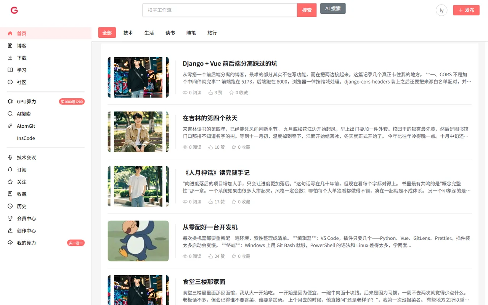
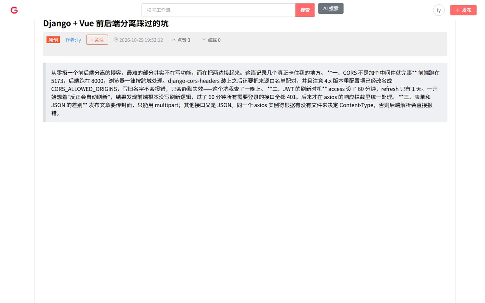
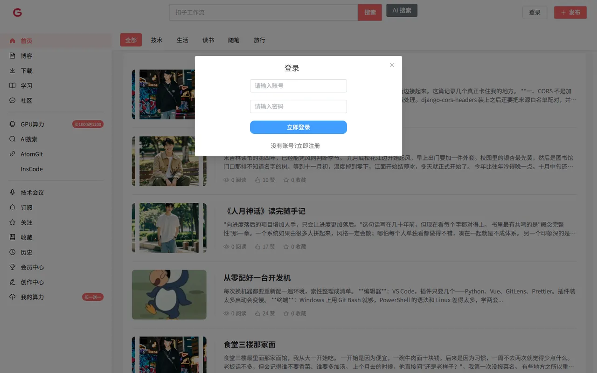
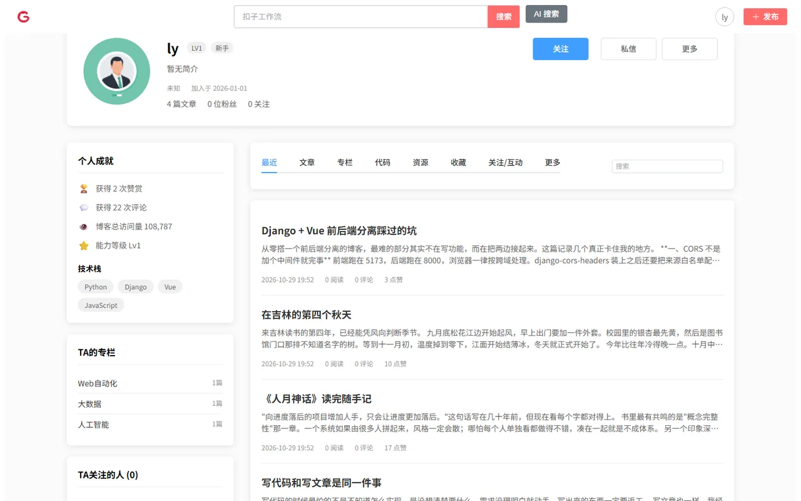

# 博客系统 · Blog

一个前后端分离的个人博客：用户注册登录、发文章（带封面和富文本）、按标题搜索、关注 / 粉丝、个人主页与数据统计。

后端 Django + DRF + SimpleJWT，前端 Vue 3 + Element Plus。

> **状态：已归档。** 线上实例和数据库都已下线，仓库作为学习和留档保留，不再维护。本地仍可完整跑起来（见[快速开始](#快速开始)）。

---

## 效果

| 首页（分类导航 + 搜索 + 文章列表） | 文章详情 |
|---|---|
|  |  |

| 登录（JWT） | 个人主页（资料 / 成就 / 文章 / 关注） |
|---|---|
|  |  |

截图是本地跑起来后实拍的，数据是 `migrate` 之后自己造的一批演示文章。

> **界面说明**：页面布局和左侧导航是照着 [GitCode](https://gitcode.com) 临摹的，用来练前后端分离的手感，不是原创设计；功能、接口和数据模型是自己写的。

---

## 功能

| 模块 | 内容 |
|---|---|
| 用户 | 注册、登录（JWT）、登出（拉黑 refresh token）、个人资料 |
| 关注 | 关注 / 取关、关注列表、粉丝列表 |
| 文章 | 列表、详情、按标题搜索、发布（multipart，可传封面）、按作者筛选 |
| 导航 | 文章分类导航 |
| 统计 | 按用户统计文章数、获赞数、关注 / 粉丝数 |

---

## 技术栈

**后端**

- Django（`settings.py` 由 Django 5.1 模板生成）+ Django REST Framework
- `djangorestframework-simplejwt`：access 60 分钟 / refresh 1 天
- `django-cors-headers`：放行本地 5173～5175
- Pillow（封面上传）、MySQL（可换 SQLite）
- 时区 `Asia/Shanghai`，语言 `zh-hans`

**前端**

- Vue 3 + Vite
- Element Plus + `@element-plus/icons-vue`
- Pinia + `pinia-plugin-persistedstate`（登录态持久化）
- Vue Router、Axios、dayjs
- `@vueup/vue-quill`（文章富文本编辑器）、Less

---

## 项目结构

```
.
├── djangoproject/              # Django 后端
│   ├── djangoproject/          # 项目配置（settings / urls / wsgi）
│   ├── user/                   # 用户、关注
│   ├── article/                # 文章
│   ├── navigation/             # 分类导航
│   ├── media/article_covers/   # 文章封面
│   └── manage.py
├── vue/
│   ├── my-vue-project/         # Vue 前端
│   │   ├── package.json
│   │   ├── vite.config.js
│   │   └── src/                # 页面 / 组件 / 路由 / store / api
│   └── package.json
└── README.md
```

数据模型三个：`Article`、`Navigation`、`Follow`。

- `Article`：标题、正文、作者、赞 / 踩、发布时间、封面、摘要、分类、slug
- `Follow`：关注关系，`(follower, followed)` 唯一
- `Navigation`：分类名

---

## 快速开始

### 后端

```bash
cd djangoproject
python -m venv venv
source venv/bin/activate          # Windows: venv\Scripts\activate
pip install -r requirements.txt

cp .env.example .env              # 填数据库密码和 SECRET_KEY

python manage.py migrate
python manage.py createsuperuser
python manage.py runserver 8000
```

数据库默认连本机 MySQL；想图省事可以直接用 SQLite，把 `.env` 里的 `DB_ENGINE` 改成 `django.db.backends.sqlite3`、`DB_NAME` 填一个文件路径即可。

接口路由挂在各 app 的短路径下：`/user/`、`/article/`、`/navigation/`，默认端口 8000，前端 `vite.config.js` 里需要配一个 `/api` 之外的代理或直接写全地址。

### 前端

```bash
cd vue/my-vue-project
npm install
npm run dev        # http://localhost:5173
```

接口地址写死在 `src/utils/request.js` 里的 `http://127.0.0.1:8000`，所以后端要先起来。文章封面是后端返回的 `/media/...` 相对路径，`vite.config.js` 里配了一条 `/media` 到 8000 的代理，否则图片会 404。

---

## 接口

所有接口返回 `{"code": 200, "data": ...}`。除标注外都需要带 `Authorization: Bearer <access>`。

**用户 `/user/`**

| 方法 | 路径 | 说明 |
|---|---|---|
| POST | `/user/register` | 注册 |
| POST | `/user/login` | 换 access + refresh（不需要 token） |
| POST | `/user/login/refresh` | 刷新 access |
| POST | `/user/logout` | 把 refresh token 拉黑 |
| POST | `/user/follow` | 关注 / 取关 |
| GET | `/user/follow/list/<user_id>` | 关注列表 |
| GET | `/user/follower/list/<user_id>` | 粉丝列表 |
| GET | `/user/profile/<user_id>` | 个人资料 |
| GET | `/user/stats/<user_id>` | 文章数 / 获赞 / 关注数 |

**文章 `/article/`**

| 方法 | 路径 | 说明 |
|---|---|---|
| GET | `/article/get` | 全部文章 |
| POST | `/article/search` | 按标题模糊搜索 |
| POST | `/article/publish` | 发布文章（需登录，multipart，可带 `cover`） |
| GET | `/article/user/<author_id>` | 某作者的文章 |

**导航 `/navigation/`**

| 方法 | 路径 | 说明 |
|---|---|---|
| GET | `/navigation/get` | 全部分类 |

---

## 已知限制

写在这里，省得接手的人重新踩一遍：

1. **前端代码比后端旧一个版本**：`src/` 是早期版本，后端后来加的 `cover`（封面上传）、`summary`、`slug` 三个字段前端没有对应 UI，`ArticleVote` 点赞表也已经不用了。页面能正常跑，但发布页不会上传封面。原机器上的绝对路径（`C:\Users\...`、`/Users/...`）已改成相对引用。
2. **数据库不在仓库里**：`*.sqlite3` / `*.db` 被 `.gitignore` 排除。想直接体验只能自己 `migrate` 后造数据。
3. **`Article.author_id` 是 `CharField` 而不是外键**，靠字符串存用户 id。当时是为了让前端好传，代价是没法用 ORM 做关联查询、也没法级联删除。正经做应该改成 `ForeignKey(AUTH_USER_MODEL)`。
4. **详情页靠 URL 传数据**：`/detail` 路由把整篇文章 JSON 序列化后塞进 query（`#/detail?data=...`），没有用 slug 去后端重新取。刷新或分享链接容易出问题，数据量也被 URL 长度卡住。
5. **`Navigation` 只是一张分类名字表**，没有层级和排序字段。
6. **`/article/get` 和 `/article/search` 都没有分页**，数据量大了会一次性返回全部结果。

---

## 说明

大二课程练习项目，用来把 Django + Vue 的前后端分离走通一遍。界面参考 GitCode，文章内容为演示数据。
